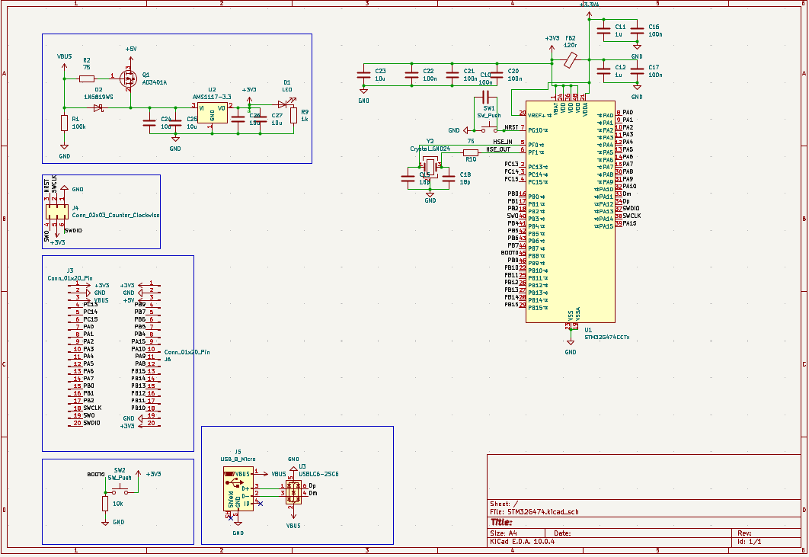
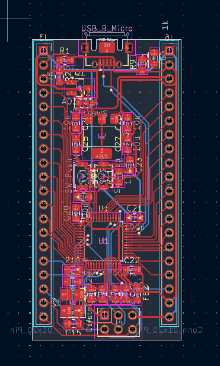

# STM32G474CCTX Devkit

## What is it?
This is small devkit(development board) with 40 pins(2X20 Pins).
## Why I made it?
I made its for serval thinks:
- To get more knowledge about devkits
- I needed more ADC inputs than Black Pill
- Preciser PWM outputs 
- Small size factor

## Hardware
I will not name all components or all feutures with, which you can experment, but some of most important:
- Mcu: STM32G474CCTX
- Clock: 16Mhz outside clock with 2 decompling capacitors
- LDO: Its have AMS1117-3.3v, but I think that you can use others if the same footprint and same A and V
- SWO/USB: Its have SWO debuging and Micro USB B

## Pinout
### Connector J3(Left)
1. Power +3.3V
2. Power GND
3. Power VBUS
4. PC13 - TIM/GPIO
5. PC14 - GPIO
6. PC15 - GPIO
7. PA0 - ADC/TIM
8. PA1 - ADC/TIM
9. PA2 - ADC/TIM
10. PA3 - ADC/TIM
11. PA4 - ADC/TIM/SPI1
12. PA5 - ADC/TIM/SPI1
13. PA6 - ADC/TIM/SPI1
14. PA7 - ADC/TIM/SPI1
15. PB0 - ADC/TIM
16. PB1 - ADC/TIM
17. PB2 - ADC/TIM
18. PA14 - SWCLK
19. PB3 - SWO
20. PA13 - SWDIO
### Connector J6(Right)
1. Power +3.3V
2. Power GND
3. Power +5V
4. PB9 - TIM/GPIO
5. PB7 - TIM/GPIO
6. PB6 - TIM/GPIO
7. PB5 - TIM/GPIO
8. PB4 - TIM/GPIO
9. PA15 - ADC/TIM
10. PA10 - TIM/GPIO
11. PA9 - ADC/TIM
12. PA8 - ADC/TIM
13. PB15 - ADC/TIM
14. PB14 - ADC/TIM
15. PB13 - ADC/GPIO
16. PB12 - ADC/GPIO
17. PB11 - ADC/TIM
18. PB10 - TIM/GPIO
19. Power GND
20. Power +3.3V
## License
Its open source with MIT license.
